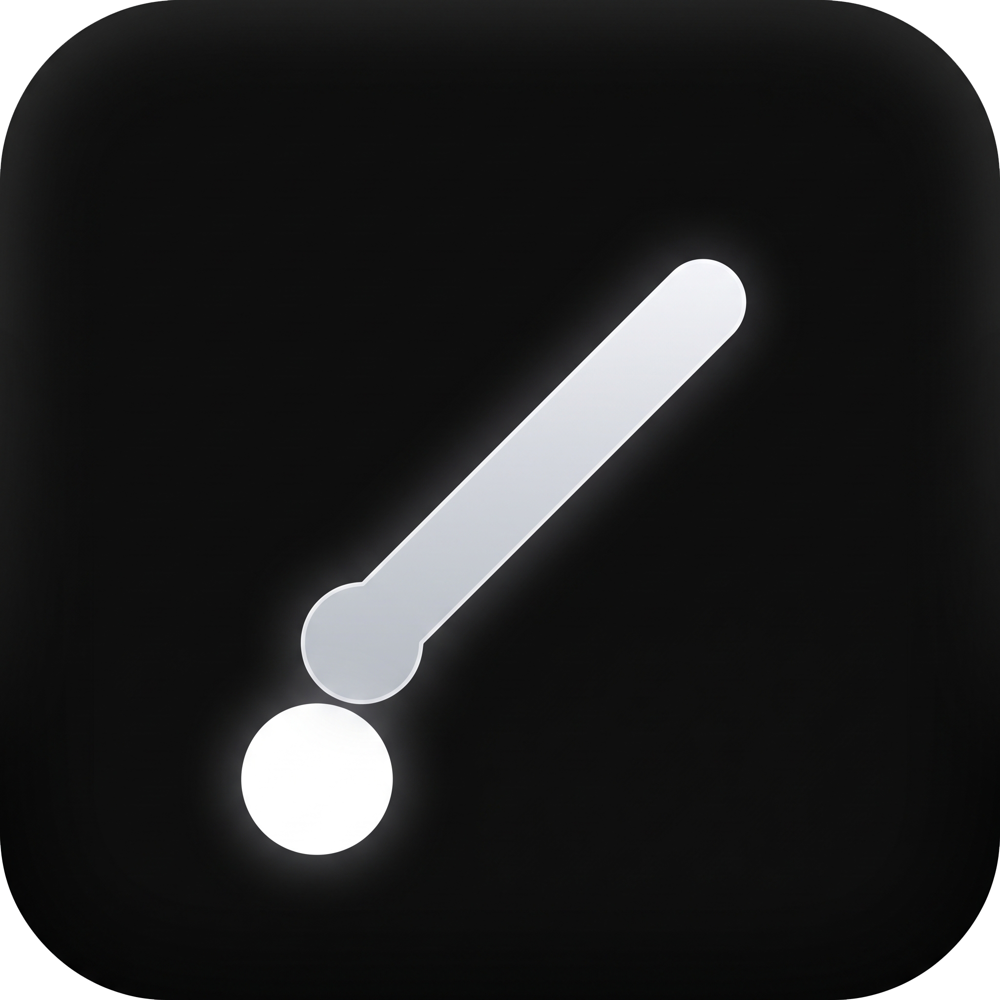

<div align="center">

  

  # Weekly Screen Pen

  <p align="center">
    <strong>Легковесная портативная утилита для быстрого рисования поверх экрана Windows</strong>
  </p>

  <p align="center">
    <a href="https://t.me/weekgamesdev">
      
    </a>
    <a href="https://github.com/Pickramag/Weekly-Screen-Pen/releases/latest">
      
    </a>
  </p>

  <p align="center">
    
    
    
    
  </p>

</div>


### ⚙️ Возможности

| Функция | Описание |
| :--- | :--- |
| 🖊 **Инструменты рисования** | Полный набор для заметок: **Ручка**, **Маркер**, полупрозрачный **Хайлайтер** и аккуратный **Ластик** |
| 🪟 **Поверх любых окон** | Создание пометок прямо на рабочем столе, в играх, видео, презентациях или IDE без переключения фокуса |
| 🖱 **Режим курсора (Pass-Through)** | Мгновенное переключение в режим прозрачных кликов, когда нажатия мыши проходят напрямую в нижележащие программы |
| 🎨 **Гибкая палитра & Кисти** | Быстрый выбор из 8 предустановленных цветов, поддержка произвольного HEX/RGB и плавная регулировка толщины (1–48 px) |
| 🧰 **Плавающая панель** | Компактная панель с быстрым доступом к функциям, которую можно перетаскивать в любую удобную точку экрана |
| 🌐 **Двуязычный интерфейс** | Встроенная поддержка русского и английского языков прямо из коробки |
| ⚡ **Zero-Footprint & Портативность** | Вес всего ~0,2 МБ. Не требует установки в реестр: конфиг `settings.json` создается рядом с исполняемым файлом |

---

### ⌨️ Горячие клавиши

| Комбинация | Действие |
| :---: | :--- |
| <kbd>Ctrl</kbd> + <kbd>Alt</kbd> + <kbd>D</kbd> | Переключение: **Режим рисования** ↔ **Режим курсора** |
| <kbd>Ctrl</kbd> + <kbd>Alt</kbd> + <kbd>Z</kbd> | Отменить последний штрих (Undo) |
| <kbd>Ctrl</kbd> + <kbd>Alt</kbd> + <kbd>X</kbd> | Полная очистка экрана |
| <kbd>Esc</kbd> | Очистить экран (когда холст рисования активен) |

---

### 🎛 Анатомия панели управления

```
┌────────────────────────────────────────────────────────────────────────┐
│  [Ручка] [Маркер] [Хайлайтер] [Ластик]  │  [Undo] [Clear]  │  [Mode] [RU/EN] [×]  │
├────────────────────────────────────────────────────────────────────────┤
│  ● ● ● ● ● ● ● ●  [Выбор цвета]              [=== Слайдер размера ===] │
└────────────────────────────────────────────────────────────────────────┘
```

- **Левая группа:** Быстрый выбор рабочих инструментов (ручка, маркер, хайлайтер, ластик).
- **Центральная группа:** Отмена последнего действия и полная очистка холста.
- **Правая группа:** Переключение режима ввода, выбор языка (RU / EN) и кнопка `×` (сворачивание в трей).
- **Нижний блок:** Быстрые пресеты палитры, кастомный ColorPicker и размер штриха.
- **Перемещение:** Панель свободно перетаскивается за любую незанятую область. Возврат из трея осуществляется двойным кликом по иконке.

---

### 📋 Системные требования

- **ОС:** Windows 10 / 11 (64-bit)
- **Среда выполнения:** [.NET 8 Desktop Runtime](https://dotnet.microsoft.com/download/dotnet/8.0) *(если компонент отсутствует, Windows автоматически предложит установить его при первом запуске)*

---

### 📥 Сборка из исходников

```powershell
# Клонирование репозитория
git clone https://github.com/Pickramag/Weekly-Screen-Pen.git
cd Weekly-Screen-Pen

# Обычная сборка Release
dotnet build src\WeeklyScreenPen\WeeklyScreenPen.csproj -c Release

# Сборка ультра-легковесного exe (~0.2 МБ, требует .NET 8 Desktop Runtime)
.\build.ps1

# Сборка автономного (Self-Contained) exe со встроенным рантаймом (~150 МБ)
.\build.ps1 -SelfContained
```

> Готовый исполняемый файл будет доступен по пути: `publish\WeeklyScreenPen.exe`.

---

### 📂 Структура проекта

```text
src\WeeklyScreenPen\
├── App.xaml(.cs)            # Точка входа, Single-Instance, сохранение конфигурации
├── OverlayWindow.xaml(.cs)  # Прозрачный fullscreen холст, глобальные хоткеи
├── ToolbarWindow.xaml(.cs)  # Плавающий оверлей панели инструментов
├── TrayIcon.cs              # Управление системным треем и контекстным меню
├── Assets\icon.ico          # Графические ресурсы и иконка
└── Core\                    # Движок рисования, хранение настроек, локализация, Win32 API
build.ps1                    # PowerShell-скрипт публикации релизных сборок
```

---

### 💬 Обратная связь & Сообщество

- 📢 Telegram-канал разработчика: [@weekgamesdev](https://t.me/weekgamesdev)
- 🐛 Баг-репорты и предложения: [GitHub Issues](https://github.com/Pickramag/Weekly-Screen-Pen/issues)

---

<div align="center">
  <sub>Лицензия <a href="LICENSE">MIT</a> • Разработано с ❤️ <a href="https://github.com/Pickramag">Pickramag</a></sub>
</div>
